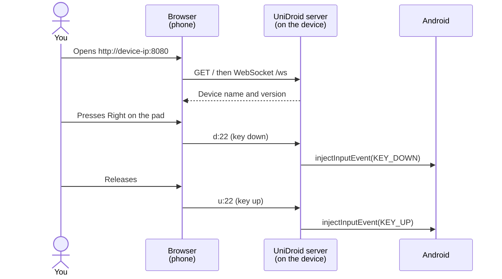

<div align="center">

# UniDroid Remote

**A fast web remote and keyboard for any Android TV, box or projector, served by the device itself.**
Free · No app · No account · No cloud · No ads

### [⬇ Install in two minutes](#-install)

[](LICENSE)


</div>

---

## ✨ Features

| | |
|---|---|
| ⚡ **Instant** | 6–8 ms per key press over Wi-Fi: one persistent process injects keys, nothing is spawned per press |
| 🎯 **Apple TV-style touch pad** | Tap an edge for a direction, swipe to scroll fast, hold to repeat |
| ⌨️ **Live keyboard** | What you type on your phone appears on the TV as you type, accents included |
| ✋ **Real long-press** | Every button sends key down / key up, so holding works like on a physical remote |
| 📲 **Installs like an app** | Add it to your home screen: full screen, own icon (iOS and Android) |
| 🚀 **Actions** | Open Android settings, the app list, or launch any app by package name |
| 🔌 **API** | HTTP and WebSocket commands for scripts, home automation or iOS Shortcuts |
| 🔒 **Local only** | No internet, no telemetry, no shell: commands only become key events |

## ⚙️ How it works

A small Java server (~10 KB of dex) runs on the device through `app_process`, the way
[scrcpy](https://github.com/Genymobile/scrcpy) runs its server. It serves the remote page and keeps
a WebSocket open with your browser. Each message becomes a key event injected with
`InputManager.injectInputEvent`.



1. The server, page and icons live in a Magisk module: [`module/`](module/). It starts at boot from [`service.sh`](module/service.sh) and restarts if it ever exits.
2. Key presses are injected directly: [`Injector.java`](server/src/com/unidroid/remote/Injector.java). Holding a key repeats it after 400 ms, every 50 ms: [`HeldKey.java`](server/src/com/unidroid/remote/HeldKey.java).
3. Actions such as "open settings" run a whitelisted command with validated arguments: [`Actions.java`](server/src/com/unidroid/remote/Actions.java).

**Why not `input keyevent`?** It starts a new Java VM on every press: about **2 s per key** on a
low-end projector (measured on an Allwinner H713 with 1 GB of RAM). The persistent server answers in milliseconds.

### Controls

| Gesture | Action |
|---|---|
| Tap the pad edge / centre | Direction / OK |
| Swipe on the pad | One step every ~34 px |
| Hold on the pad edge or any button | Key repeat / long-press |
| ⚙ / Apps buttons | Android settings / app list of [UniDroid Launcher](https://github.com/trk78/unidroid-launcher) (home screen without it) |
| Keyboard button | Live typing, ⌫ and ⏎ |
| Arrow keys, Enter, Esc, Space (desktop) | D-pad, OK, Back, Play/Pause |

## 🚀 Install

Requirements: `adb` on your computer, a JDK 11+ and the Android SDK (any platform + build-tools) to build the server.

**Rooted device (recommended)**: installs as a Magisk module, starts at every boot.

```bash
git clone https://github.com/trk78/unidroid-remote.git
cd unidroid-remote
./install.sh 192.168.1.50:5555   # your device's adb serial or ip:port
```

**Without root**: the `shell` user may inject input too, but nothing restarts it after a reboot.

```bash
./build.sh
adb push module/. /data/local/tmp/udr
adb shell 'CLASSPATH=/data/local/tmp/udr/unidroid-server.jar nohup app_process / \
  com.unidroid.remote.Server 8080 /data/local/tmp/udr/webroot >/dev/null 2>&1 &'
```

Then open `http://<device-ip>:8080` on a phone on the same Wi-Fi.
On iPhone, **Share → Add to Home Screen** turns it into an app.

| Command | Effect |
|---|---|
| `./build.sh` | Builds `module/unidroid-server.jar` (javac + d8) |
| `./install.sh [serial]` | Builds if needed, installs the Magisk module, starts the server |
| `UDR_PORT=9000 ./install.sh` | Same, on another port |
| `python scripts/make-icons.py` | Re-renders the PNG icons (needs Pillow) |

To uninstall, disable or remove the module in the Magisk app and reboot.

## 🔌 API

Everything the page does is available to your own scripts.

| HTTP GET | Example |
|---|---|
| `/key?k=<key>` | `/key?k=DPAD_UP`, `/key?k=HOME`, `/key?k=26` |
| `/text?t=<text>` | `/text?t=hello%20world` |
| `/action?a=<action>` | `settings`, `apps`, `launch:com.google.android.youtube.tv` |
| `/info` | `{"name":"HY300","maker":"askey","android":"11","version":"0.3.0"}` |

**WebSocket** `/ws`, one text message per command:

| Message | Effect |
|---|---|
| `d:<key>` / `u:<key>` | Key down (repeats while held) / key up |
| `k:<key>` | Tap |
| `t:<text>` | Type text |
| `b:<n>` | `n` backspaces |
| `a:<action>` | Same actions as `/action` |
| `p` | Ping, answered with `p` (the page shows the round trip) |

`<key>` is an Android keycode number or name (`22`, `DPAD_RIGHT`, `KEYCODE_DPAD_RIGHT`).

## 🗂️ Project structure

```
├── server/src/com/unidroid/remote/
│   ├── Server.java          — HTTP + WebSocket server, static files, /info
│   ├── Injector.java        — Key and text injection (InputManager)
│   ├── HeldKey.java         — Press-and-hold with auto-repeat
│   └── Actions.java         — Whitelisted actions (settings, apps, launch)
├── module/                  — Magisk module, copied as-is to the device
│   ├── module.prop
│   ├── service.sh           — Boot start + respawn loop
│   └── webroot/             — The remote page, manifest and icons (icon.svg is the source)
├── scripts/
│   ├── device-install.sh    — On-device installer (root)
│   └── make-icons.py        — PNG icons from the icon geometry
├── build.sh                 — Builds the server jar
└── install.sh               — One-command install over adb
```

## ⚠️ Known limitations

- **No authentication**: anyone on your network who can reach the port controls the device. Keep it on a trusted LAN and **never expose port 8080 to the internet**.
- **Plain HTTP**: browsers only allow service workers over HTTPS, so there is no offline mode and Chrome on Android shows no install prompt. *Add to Home Screen* still works on iOS and Android.
- **Hidden Android APIs**: `InputManager.injectInputEvent` is not public. Android 14's move to `InputManagerGlobal` is handled; future versions may need updates.
- **Vendor key handling**: some firmwares intercept keys. On the HY300, `MENU` always opens the vendor settings, which is why the remote uses actions for ⚙ and Apps.
- **Tested on**: Magcubic HY300 (Allwinner H713, Android 11, Magisk). Reports from other devices are welcome.

## 🤝 Contributing

Issues and pull requests are welcome: [open an issue](https://github.com/trk78/unidroid-remote/issues).

Open ideas:
- custom buttons (any keycode or app shortcut) saved per device;
- optional PIN for shared networks;
- projector controls (keystone, zoom, focus) from the remote;
- a flashable Magisk zip in GitHub Releases, so no JDK or SDK is needed;
- install the remote from [UniDroid Launcher](https://github.com/trk78/unidroid-launcher), the companion TV home screen.

## 📄 License

[MIT](LICENSE) © Timéo Jeannin
