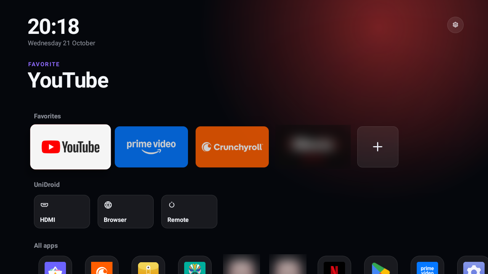
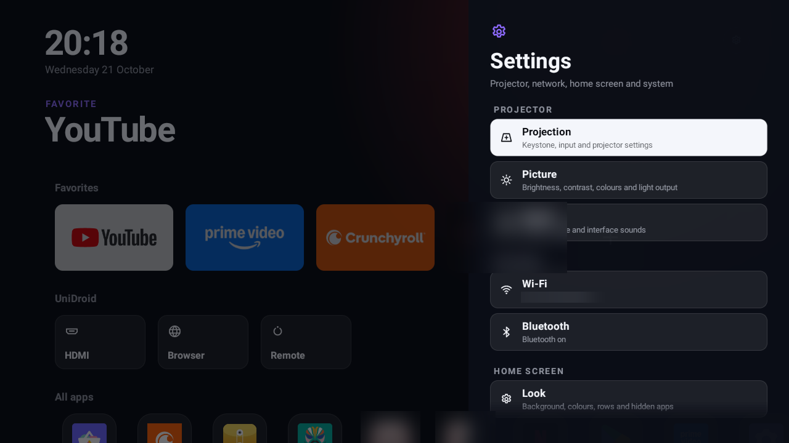
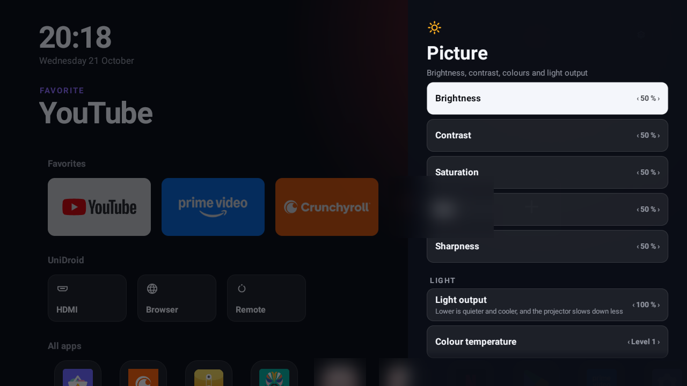
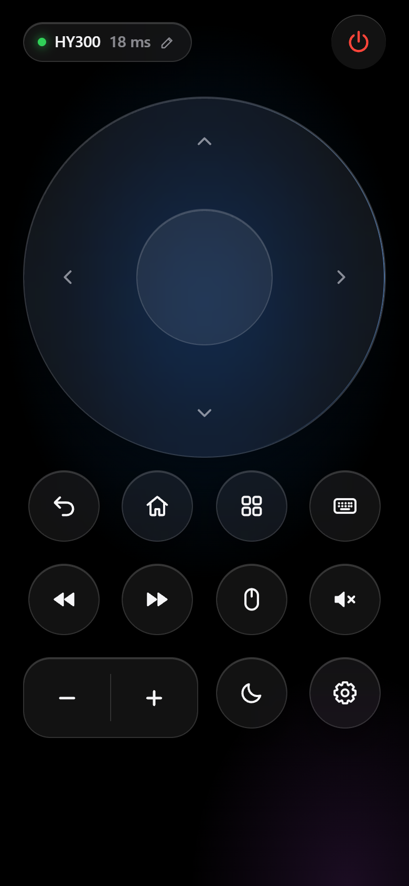
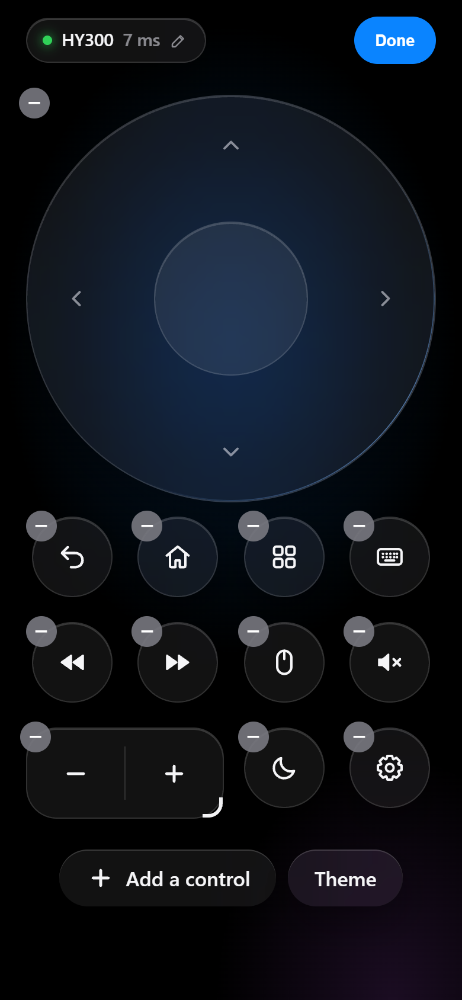
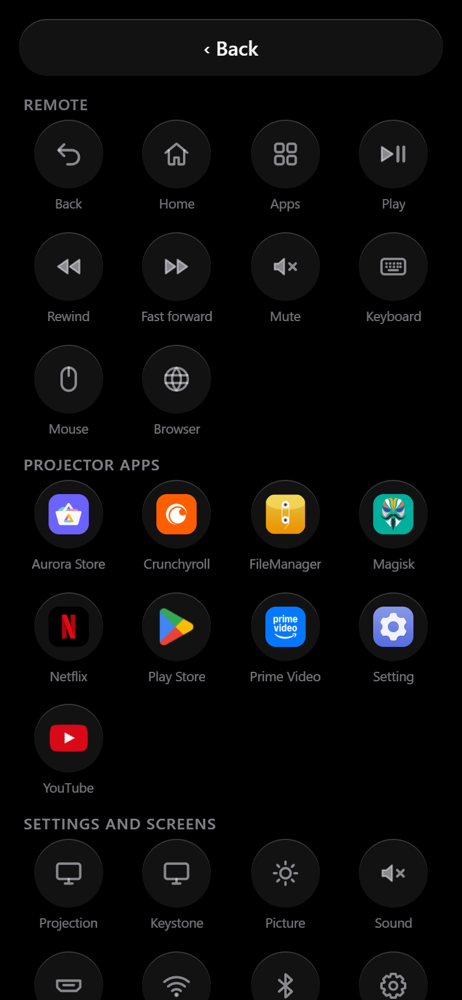
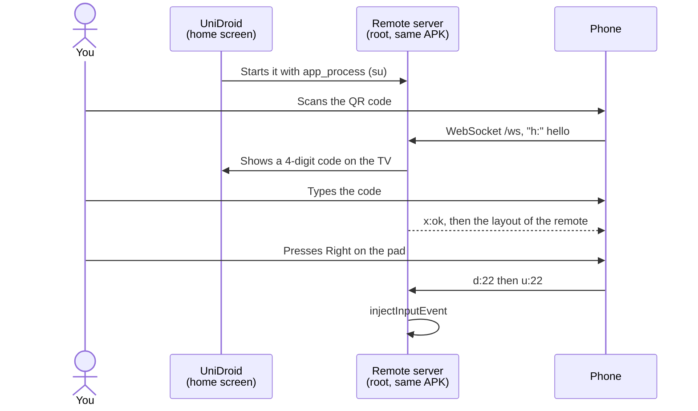

<div align="center">

# UniDroid Suite

**A fast home screen for Android TV boxes and projectors, with a phone remote built in.**
Free · No ads · No account · No cloud · One ~430 KB app

### [⬇ Download UniDroid 1.0.0](https://github.com/trk78/unidroid-suite/releases/latest)

[](LICENSE)
[](https://github.com/trk78/unidroid-suite/releases/latest)


</div>

---

UniDroid replaces the home screen of an Android TV box or projector and serves a remote control to your phone:
open it from a QR code, add it to your home screen, and it works like an app. It was built for a rooted
Magcubic HY300 projector, whose vendor launcher showed ads and whose settings were scattered across several apps.

## 📸 Screenshots

<p align="center">
  
</p>

<p align="center">
  
  
</p>

<p align="center">
  
  
  
</p>

## ✨ Features

**Home screen**

| | |
|---|---|
| ⚡ **Light** | Plain Android views, no AndroidX, no Gradle: opens instantly on 1 GB devices |
| ⭐ **Favorites** | Big 16:9 app banners. Hold OK on any app for its menu: pin, move, hide, app info, uninstall |
| 🎨 **Looks** | Backgrounds (app glow, animated aurora and nebula, gradient, halo, black) in six palettes, accent colour, four clock styles |
| 🧩 **Layout** | Row order, apps sorted by name or in your own order, icon size, app names on or off, hidden apps |
| 🪟 **One Settings menu** | Projector (keystone, projection mode, zoom, picture, sound), network (Wi-Fi, Bluetooth), home screen, system (sleep timer, about) |
| 📐 **Keystone** | Full-screen editor: OK picks a corner, arrows move it, hold OK to reset; zoom shrinks the picture evenly on top |
| 🖼️ **Picture** | Brightness, contrast, saturation, hue, sharpness, light output and colour temperature, through the projector's own picture service |
| 📺 **HDMI** | One tile opens the HDMI input; optionally switch to it when the HDMI device wakes up (HDMI-CEC) |
| 🌐 **Remote-driven browser** | The projector shows only the page; address bar, tabs, bookmarks and a track pad are on the phone |
| 🌍 **English and French** | Follows the device language |

**Phone remote**

| | |
|---|---|
| 🎛️ **Control Center layout** | A grid of tiles like iOS Control Center: tap the status pill to edit, drag to move, − to remove, add projector apps, settings screens, links, the sleep timer or the mouse |
| 🔐 **Pairing** | A new phone types a 4-digit code shown on the TV, once. Only paired phones control the projector |
| 🖱️ **Mouse mode** | A virtual mouse: Android's own pointer, clicks and scrolling in every app |
| 🎯 **Touch pad** | Tap an edge for a direction, swipe to scroll fast, hold to repeat |
| ⌨️ **Live keyboard** | What you type on the phone appears on the TV as you type, accents included |
| 🌙 **Sleep timer** | One tile: 15, 30, 60 or 90 minutes, with the minutes left on it |
| 🎨 **Theme** | Per phone: six colours, light, dark or automatic |
| ⚡ **Instant** | 6–8 ms per key press over Wi-Fi: one persistent process injects keys, nothing is spawned per press |
| 📲 **Installs like an app** | Add it to the home screen: full screen, own icon (iOS and Android) |
| 🔒 **Local only** | No internet, no telemetry, no shell: commands only become key events and whitelisted actions |

## 🚀 Install

You need a rooted device (Magisk) for the remote, keystone, picture and mouse. The home screen works without root.

1. Download `unidroid-1.0.0.apk` from the [latest release](https://github.com/trk78/unidroid-suite/releases/latest).
2. Install it and make it the home app:
   ```bash
   adb install -r unidroid-1.0.0.apk
   adb shell cmd package set-home-activity app.unidroid.launcher/.HomeActivity
   ```
3. Press **Home**. Magisk asks once for root: grant it.
4. On your phone, scan the QR code on the **Remote** tile, type the code shown on the TV, then **Share → Add to Home Screen** (iPhone).

Tip: reserve the projector's IP address in your router, so the phone app always finds it.

## ⚙️ How it works

The app holds both sides. The home screen is a normal Android app. The remote server is a small Java program
in the same APK, started as root with `app_process` (the way [scrcpy](https://github.com/Genymobile/scrcpy) runs
its server). It serves the remote page from the APK, injects key events with `InputManager.injectInputEvent`
and calls the projector's vendor services.



1. The home screen, panels and settings are built in code, without XML layouts: [`src/app/unidroid/launcher/`](src/app/unidroid/launcher/).
2. [`RemoteLink.java`](src/app/unidroid/launcher/RemoteLink.java) starts the server as root, restarts it after an app update (new APK path) and reads its state.
3. Pairing: [`Pairing.java`](src/app/unidroid/remote/Pairing.java) keeps the paired phones and asks [`PairActivity`](src/app/unidroid/launcher/PairActivity.java) to show the code over whatever is on screen.
4. The remote layout is stored on the projector and pushed to every phone, so all phones show the same remote.
5. Picture and projection mode use the Allwinner HIDL service `vendor.aw.homlet.tvsystem.tvserver@1.0::ITvServer`, the same calls as the vendor's settings app ([`TvServer.java`](src/app/unidroid/remote/TvServer.java)).
6. Keystone and zoom send four corners to SurfaceFlinger (transaction 1050) as fractions of the screen ([`KeystoneDaemon.java`](src/app/unidroid/launcher/KeystoneDaemon.java)).
7. Mouse mode registers a virtual USB mouse with Android's `hid` tool (`/dev/uhid`): [`VirtualMouse.java`](src/app/unidroid/remote/VirtualMouse.java).
8. Auto HDMI follows the HDMI-CEC service's log for the HDMI device waking up: [`HdmiWatch.java`](src/app/unidroid/remote/HdmiWatch.java).
9. Animated backgrounds only move a few blurred shapes drawn once into hardware layers: nothing is redrawn per frame ([`Backdrop.java`](src/app/unidroid/launcher/Backdrop.java)).

**Why not `input keyevent`?** It starts a new Java VM on every press: about **2 s per key** on a low-end
projector (measured on an Allwinner H713 with 1 GB of RAM). The persistent server answers in milliseconds.

## 🛠️ Build from source

Requirements: a JDK 11+, the Android SDK (any platform + build-tools), Python 3 and `adb`.

```bash
git clone https://github.com/trk78/unidroid-suite.git
cd unidroid-suite
./build.sh
adb install -r build/unidroid.apk
```

| Command | Effect |
|---|---|
| `./build.sh` | Builds `build/unidroid.apk` with aapt2, javac, d8, zipalign and apksigner |
| `KEYSTORE=… KEY_ALIAS=… KEY_PASS=… ./build.sh` | Signs with your own key instead of the debug key |
| `python scripts/make-icons.py` | Re-renders the remote's PNG icons (needs Pillow) |

## 🔌 API

The remote server listens on port 8080. Calls from the network need a paired phone: send its id in the
`X-UDR-Device` header (the page does this itself).

| HTTP GET | Example |
|---|---|
| `/key?k=<key>` | `/key?k=DPAD_UP`, `/key?k=HOME`, `/key?k=26` |
| `/text?t=<text>` | `/text?t=hello%20world` |
| `/action?a=<action>` | `apps`, `browser`, `hdmi`, `settings`, `open:<screen>`, `launch:<package>`, `url:<address>`, `sleep:<minutes>`, `autohdmi:<0\|1>` |
| `/apps`, `/icon?p=<package>` | The projector's apps and their icons |
| `/info` | Device name, Android version, server version |

`<screen>` is one of `apps`, `remote`, `keystone`, `projection`, `picture`, `sound`, `wifi`, `bluetooth`, `settings`, `about`.

**WebSocket** `/ws`, one text message per command:

| Message | Effect |
|---|---|
| `h:<id>␉<0\|1>␉<name>[␉<code>]` | Hello: who the page is, whether it runs from the home screen, and the pairing code when asked (`x:pair`, `x:wrong`, `x:ok`) |
| `d:<key>` / `u:<key>` | Key down (repeats while held) / key up |
| `k:<key>` | Tap |
| `t:<text>` / `b:<n>` | Type text / `n` backspaces |
| `a:<action>` | Same actions as `/action` |
| `m:<dx> <dy>`, `m:c`, `m:d`, `m:u`, `m:s <v> <h>` | Mouse: move, click, button down, button up, scroll |
| `l:<json>` | Save the remote layout (sent to every phone) |
| `w:<command>` | Browser: `show`, `open <url or search>`, `new`, `tab <id>`, `close <id>`, `back`, `forward`, `reload`, `move`, `click`, `scroll`, `zoom`, `mode`, `type`, `del`, `enter`, `exit`, `state` |
| `p` | Ping, answered with `p` |

The server also sends `z:<epoch ms>` (sleep timer deadline, 0 when off). `<key>` is an Android keycode
number or name (`22`, `DPAD_RIGHT`, `KEYCODE_DPAD_RIGHT`).

## 🗂️ Project structure

```
├── AndroidManifest.xml
├── src/app/unidroid/
│   ├── launcher/                — The app (home screen)
│   │   ├── HomeActivity.java    — Home screen: clock, hero, rows, remote tile
│   │   ├── Backdrop.java        — Backgrounds (still and animated) and palettes
│   │   ├── Sheet.java           — Side panel: header and focusable rows
│   │   ├── SettingsPanel.java   — Settings by category, home look, per-app menu
│   │   ├── ProjectionPanel.java — Keystone, projection mode, zoom, HDMI
│   │   ├── PicturePanel.java / SoundPanel.java / AboutPanel.java
│   │   ├── WifiPanel.java / BluetoothPanel.java
│   │   ├── KeystoneEditor.java / KeystoneDaemon.java — Keystone editor and root helper
│   │   ├── BrowserActivity.java / BrowserControl.java — Remote-driven browser
│   │   ├── RemotePanel.java / RemoteLink.java — Paired phones, QR code, server control
│   │   ├── PairActivity.java    — Pairing code on the TV
│   │   ├── AppExport.java       — App list and icons for the remote
│   │   ├── QrCode.java / QrView.java — QR code encoder and view
│   │   └── AppRepo, Prefs, Root, Tv, Ui
│   └── remote/                  — The remote server (run with app_process)
│       ├── Server.java          — HTTP + WebSocket server, pairing gate, sleep timer
│       ├── Pairing.java / Devices.java — Paired phones, one row per phone
│       ├── TvServer.java        — Picture and panel settings (vendor HIDL)
│       ├── VirtualMouse.java    — System mouse through /dev/uhid
│       ├── HdmiWatch.java       — Auto HDMI from the CEC log
│       ├── BrowserRelay.java    — Phone ⇄ browser ("w:" messages)
│       ├── Injector.java / HeldKey.java — Key and text injection, auto-repeat
│       ├── Media.java           — Media viewer for the browser
│       └── Actions.java         — Whitelisted actions
├── assets/remote/               — The remote page, manifest and icons
├── res/                         — Strings (English, French), icons, TV banner
├── scripts/make-icons.py        — PNG icons from the icon geometry
└── build.sh                     — Gradle-free build
```

## ⚠️ Known limitations

- **Root** is needed for the remote, keystone, picture, mouse and HDMI features. Without it, the home screen and Wi-Fi/Bluetooth panels still work.
- **Plain HTTP on your LAN**: pairing keeps strangers out, but traffic is not encrypted. **Never expose port 8080 to the internet.**
- **Browser engine**: the system WebView. On the HY300 it is version 83 (2020): some recent sites may not work.
- **Vendor services**: picture, projection mode and keystone calls are those of Allwinner H713 projectors. Other devices get the home screen and remote, not these panels.
- **Colour temperature** levels have no names in the vendor app: they are shown as levels 1 to 3.
- **Hidden Android APIs**: `InputManager.injectInputEvent`, `HwBinder`, Bluetooth connect/disconnect. Android 14's `InputManagerGlobal` is handled.
- **Tested on**: Magcubic HY300 (Allwinner H713, Android 11, Magisk).

## 🤝 Contributing

Issues and pull requests are welcome: [open an issue](https://github.com/trk78/unidroid-suite/issues).

Open ideas:
- USB drive and media browser;
- the projector as a Bluetooth speaker;
- app management (clear cache, force stop);
- a wallpaper sent from the phone.

## 📄 License

[MIT](LICENSE) © Timéo Jeannin
