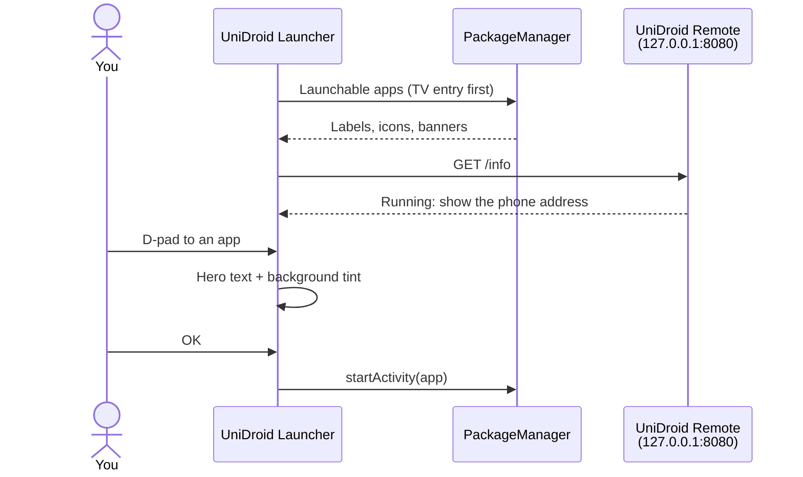

<div align="center">

# UniDroid Launcher

**A fast, lightweight home screen for Android TV boxes and projectors, with projector controls built in.**
Free · No ads · No premium tier · No account · ~80 KB

### [⬇ Build and install](#-build-and-install)

[](LICENSE)


</div>

---

## ✨ Features

| | |
|---|---|
| ⚡ **Light** | Plain Android views, no AndroidX, no Gradle: an ~80 KB APK that opens instantly on 1 GB devices |
| ⭐ **Favorites** | Big 16:9 app banners. Hold OK on any app to pin or unpin it |
| 🎨 **Dynamic background** | The glow behind the screen takes the colour of the focused app |
| 📽️ **Projector row** | Projection settings (keystone, zoom, mode), Wi-Fi and Bluetooth one click away |
| 📱 **UniDroid Remote aware** | Detects [UniDroid Remote](https://github.com/trk78/unidroid-remote) and shows the address to open on your phone |
| 🌍 **English and French** | Follows the device language |
| 📺 **Any screen** | Laid out on a 1920-unit grid, identical on 720p and 1080p |

## ⚙️ How it works



1. Apps are listed from the `LEANBACK_LAUNCHER` and `LAUNCHER` entry points, TV entry preferred: [`AppRepo.java`](src/app/unidroid/launcher/AppRepo.java).
2. Favorites are package names saved in the app's preferences. First run picks known streaming apps, then any app with a TV banner.
3. The home screen is built in code, without XML layouts: [`HomeActivity.java`](src/app/unidroid/launcher/HomeActivity.java).
4. Projector shortcuts are only shown when the device answers the matching settings intent.

## 🚀 Build and install

Requirements: a JDK 11+, the Android SDK (any platform + build-tools), Python 3 and `adb`.

```bash
git clone https://github.com/trk78/unidroid-launcher.git
cd unidroid-launcher
./build.sh
adb install -r build/unidroid-launcher.apk
```

Then press **Home** and pick UniDroid Launcher, or make it the default from adb:

```bash
adb shell cmd package set-home-activity app.unidroid.launcher/.HomeActivity
```

| Command | Effect |
|---|---|
| `./build.sh` | Builds `build/unidroid-launcher.apk` with aapt2, javac, d8, zipalign and apksigner |
| `KEYSTORE=… KEY_ALIAS=… KEY_PASS=… ./build.sh` | Signs with your own key instead of the debug key |

## 🗂️ Project structure

```
├── AndroidManifest.xml         — HOME + LEANBACK_LAUNCHER entry, package visibility queries
├── src/app/unidroid/launcher/
│   ├── HomeActivity.java       — Home screen: clock, hero, rows, focus effects
│   └── AppRepo.java            — Installed apps, favorites, banner colour
├── res/
│   ├── drawable/               — Vector icons
│   ├── drawable-nodpi/         — App icon and TV banner
│   ├── values/                 — English strings
│   └── values-fr/              — French strings
└── build.sh                    — Gradle-free build
```

## ⚠️ Known limitations

- **Early version (0.1)**: no settings screen, no wallpaper choice, no app reordering yet.
- **Projector controls** open the vendor's own screens. Direct keystone and zoom control needs system rights, planned through UniDroid Remote on rooted devices.
- **Tested on**: Magcubic HY300 (Allwinner H713, Android 11).

## 🤝 Contributing

Issues and pull requests are welcome: [open an issue](https://github.com/trk78/unidroid-launcher/issues).

Open ideas:
- keystone, zoom, focus and input switching directly from the launcher (through UniDroid Remote);
- install UniDroid Remote from the launcher, with a QR code to open it on the phone;
- side menu with categories, custom wallpapers, reorder favorites;
- custom remote buttons configured from the TV.

## 📄 License

[MIT](LICENSE) © Timéo Jeannin
