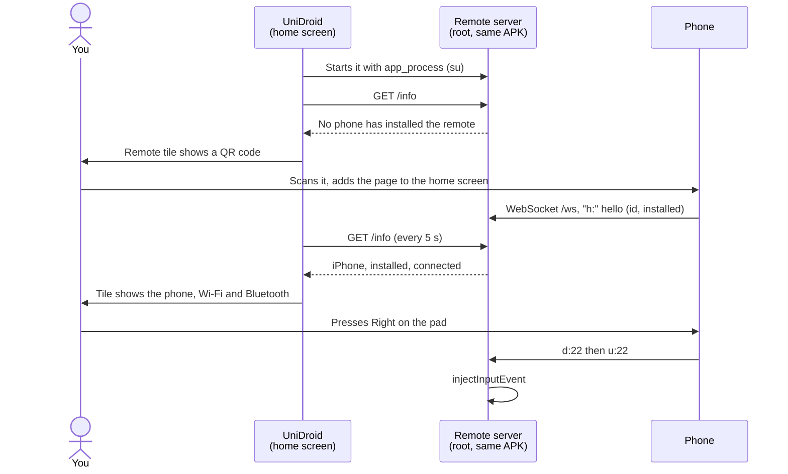

<div align="center">

# UniDroid Suite

**A fast home screen for Android TV boxes and projectors, with a phone remote built in.**
Free · No ads · No account · No cloud · One ~370 KB app

### [⬇ Build and install](#-build-and-install)

[](LICENSE)


</div>

---

UniDroid Suite merges two projects that used to live apart: **UniDroid Launcher**, a home screen for TV devices,
and **UniDroid Remote**, a web remote served by the device itself. One app now does both. The launcher runs the
remote server and shows a QR code until a phone has added the remote to its home screen.

## ✨ Features

**Home screen**

| | |
|---|---|
| ⚡ **Light** | Plain Android views, no AndroidX, no Gradle: opens instantly on 1 GB devices |
| ⭐ **Favorites** | Big 16:9 app banners, three sizes. Hold OK on any app for its menu: pin, move, hide, app info, uninstall |
| 🎨 **Customizable** | Background (app colour, accent, plain black), six accent colours, clock on/off, rows on/off, hidden apps |
| 🪟 **Native panels** | Wi-Fi (scan, connect, forget), Bluetooth (pair, connect, forget), projection and remote open as side panels |
| 📐 **Keystone** | Full-screen editor: OK picks a corner, arrows move it (faster while held), hold OK to reset (rooted Allwinner H713 projectors) |
| 🌐 **Remote-driven browser** | The projector shows only the page and a pointer; address bar, tabs, bookmarks, back/forward, zoom and desktop/mobile mode are on the phone |
| 🌍 **English and French** | Follows the device language |

**Phone remote**

| | |
|---|---|
| 🖱️ **Track pad for the web** | In the Web tab: slide to move the pointer, tap to click, two fingers or the side strip to scroll, the phone keyboard types into the page |
| 📷 **QR code on the TV** | Scan it with the phone camera; once the remote is on the phone's home screen, the tile shows the phone, Wi-Fi and Bluetooth instead |
| ⚡ **Instant** | 6–8 ms per key press over Wi-Fi: one persistent process injects keys, nothing is spawned per press |
| 🎯 **Apple TV-style touch pad** | Tap an edge for a direction, swipe to scroll fast, hold to repeat |
| ⌨️ **Live keyboard** | What you type on the phone appears on the TV as you type, accents included (also in web pages) |
| 📲 **Installs like an app** | Add it to the home screen: full screen, own icon (iOS and Android) |
| 🔌 **API** | HTTP and WebSocket commands for scripts, home automation or iOS Shortcuts |
| 🔒 **Local only** | No internet, no telemetry, no shell: commands only become key events |

## ⚙️ How it works

The app holds both sides. The home screen is a normal Android app. The remote server is a small Java program
in the same APK, started as root with `app_process` (the way [scrcpy](https://github.com/Genymobile/scrcpy) runs
its server). It serves the remote page from the APK and injects key events with `InputManager.injectInputEvent`.



1. The home screen, panels and settings are built in code, without XML layouts: [`src/app/unidroid/launcher/`](src/app/unidroid/launcher/).
2. [`RemoteLink.java`](src/app/unidroid/launcher/RemoteLink.java) starts the server as root, restarts it after an app update (new APK path) and reads its state. A standalone UniDroid Remote Magisk module, if present, is retired.
3. The server keeps a list of the phones that opened the remote ([`Devices.java`](src/app/unidroid/remote/Devices.java)). A page opened from the home screen reports itself as installed; that switches the tile from the QR code to the status button.
4. The QR code is drawn by a small encoder with no dependency: [`QrCode.java`](src/app/unidroid/launcher/QrCode.java).
5. The browser ([`BrowserActivity.java`](src/app/unidroid/launcher/BrowserActivity.java)) is a full-screen WebView with a drawn pointer. Clicks are real mouse events (no tap-to-zoom, hover works) and scrolling is a mouse wheel at the pointer. Its control socket listens on 127.0.0.1:8090 only; the remote server relays the phone's `w:` messages to it and sends its state (tabs, address, progress) back to every phone ([`BrowserRelay.java`](src/app/unidroid/remote/BrowserRelay.java)).
6. Keystone sends four corners to SurfaceFlinger (transaction 1050) as fractions of the screen, through a root helper that only applies the latest position: [`KeystoneDaemon.java`](src/app/unidroid/launcher/KeystoneDaemon.java).

**Why not `input keyevent`?** It starts a new Java VM on every press: about **2 s per key** on a low-end
projector (measured on an Allwinner H713 with 1 GB of RAM). The persistent server answers in milliseconds.

### Remote controls

| Gesture | Action |
|---|---|
| Tap the pad edge / centre | Direction / OK |
| Swipe on the pad | One step every ~34 px |
| Hold on the pad edge or any button | Key repeat / long-press |
| ⚙ / Apps buttons | Android settings / the home screen's app row |
| Keyboard button | Live typing, ⌫ and ⏎ |
| Arrow keys, Enter, Esc, Space (desktop) | D-pad, OK, Back, Play/Pause |

## 🚀 Build and install

Requirements: a JDK 11+, the Android SDK (any platform + build-tools), Python 3 and `adb`.
The remote and keystone need root (Magisk); the home screen works without it.

```bash
git clone https://github.com/trk78/unidroid-suite.git
cd unidroid-suite
./build.sh
adb install -r build/unidroid.apk
adb shell cmd package set-home-activity app.unidroid.launcher/.HomeActivity
```

Press **Home**: the launcher starts the remote server (Magisk asks once for root). Scan the QR code on the
**Remote** tile with your phone, then **Share → Add to Home Screen** on iPhone.

| Command | Effect |
|---|---|
| `./build.sh` | Builds `build/unidroid.apk` with aapt2, javac, d8, zipalign and apksigner |
| `KEYSTORE=… KEY_ALIAS=… KEY_PASS=… ./build.sh` | Signs with your own key instead of the debug key |
| `python scripts/make-icons.py` | Re-renders the remote's PNG icons (needs Pillow) |

## 🔌 API

The remote server listens on port 8080. Everything the page does is available to your own scripts.

| HTTP GET | Example |
|---|---|
| `/key?k=<key>` | `/key?k=DPAD_UP`, `/key?k=HOME`, `/key?k=26` |
| `/text?t=<text>` | `/text?t=hello%20world` |
| `/action?a=<action>` | `settings`, `apps`, `keystone`, `browser`, `launch:com.google.android.youtube.tv` |
| `/info` | `{"name":"HY300","maker":"askey","android":"11","version":"0.4.0"}` (from the device itself: also the APK in use and the known phones) |

**WebSocket** `/ws`, one text message per command:

| Message | Effect |
|---|---|
| `h:<id>␉<0\|1>␉<name>` | First message: who the page is, and whether it runs from the home screen |
| `d:<key>` / `u:<key>` | Key down (repeats while held) / key up |
| `k:<key>` | Tap |
| `t:<text>` | Type text |
| `b:<n>` | `n` backspaces |
| `a:<action>` | Same actions as `/action` (also `browser`) |
| `w:<command>` | Browser: `show`, `open <url or search>`, `new [url]`, `tab <id>`, `close <id>`, `back`, `forward`, `reload`, `stop`, `move <dx> <dy>`, `click`, `scroll <dx> <dy>`, `zoom in\|out`, `mode desktop\|mobile`, `exit`, `state`. The browser answers `w:<json>` with its tabs and state |
| `p` | Ping, answered with `p` (the page shows the round trip) |

`<key>` is an Android keycode number or name (`22`, `DPAD_RIGHT`, `KEYCODE_DPAD_RIGHT`).

The home screen also opens screens on request:
`adb shell am start -n app.unidroid.launcher/.HomeActivity --es open apps|remote|keystone`.

## 🗂️ Project structure

```
├── AndroidManifest.xml
├── src/app/unidroid/
│   ├── launcher/                — The app (home screen)
│   │   ├── HomeActivity.java    — Home screen: clock, hero, rows, remote tile
│   │   ├── Sheet.java           — Side panel: header and focusable rows
│   │   ├── WifiPanel.java       — Wi-Fi: scan, connect with a password, forget
│   │   ├── BluetoothPanel.java  — Bluetooth: paired devices, scan, pair, forget
│   │   ├── ProjectionPanel.java — Keystone, HDMI input
│   │   ├── KeystoneEditor.java  — Full-screen keystone editor (root)
│   │   ├── KeystoneDaemon.java  — Root helper: applies only the latest corners
│   │   ├── BrowserActivity.java — Full-screen browser: tabs, pointer, mouse clicks and wheel
│   │   ├── BrowserControl.java  — Its control socket (127.0.0.1:8090)
│   │   ├── RemotePanel.java     — Phones, QR code, Wi-Fi, Bluetooth, server
│   │   ├── RemoteLink.java      — Starts the remote server and reads its state
│   │   ├── QrCode.java / QrView.java — QR code encoder and view
│   │   ├── SettingsPanel.java   — Launcher settings and the per-app menu
│   │   └── AppRepo, Prefs, Root, Ui
│   └── remote/                  — The remote server (run with app_process)
│       ├── Server.java          — HTTP + WebSocket server, files from the APK, /info
│       ├── Devices.java         — Phones that opened the remote
│       ├── BrowserRelay.java    — Relays phone ⇄ browser ("w:" messages)
│       ├── Injector.java        — Key and text injection (InputManager)
│       ├── HeldKey.java         — Press-and-hold with auto-repeat
│       └── Actions.java         — Whitelisted actions (settings, apps, keystone, launch)
├── assets/remote/               — The remote page, manifest and icons (icon.svg is the source)
├── res/                         — Strings (English, French), icons, TV banner
├── scripts/make-icons.py        — PNG icons from the icon geometry
└── build.sh                     — Gradle-free build
```

## ⚠️ Known limitations

- **Root for the remote and keystone**: key injection and SurfaceFlinger calls need system rights. Without root, the home screen and panels still work.
- **No authentication on the remote**: anyone on your network who can reach port 8080 controls the device. Keep it on a trusted LAN and **never expose port 8080 to the internet**.
- **Plain HTTP**: no service worker, so no offline mode and no install prompt in Chrome on Android. *Add to Home Screen* still works on iOS and Android.
- **Browser engine**: the system WebView. On the HY300 it is version 83 (2020): some recent sites may not work until it is updated.
- **Keystone latency**: SurfaceFlinger takes 0.2–0.4 s per change on the HY300 (it saves eight properties each time).
- **Projection mode and zoom** still open the vendor's screen: they go through a private vendor service not mapped yet.
- **Hidden Android APIs**: `InputManager.injectInputEvent`, Bluetooth connect/disconnect. Android 14's `InputManagerGlobal` is handled.
- **Tested on**: Magcubic HY300 (Allwinner H713, Android 11, Magisk).

## 🤝 Contributing

Issues and pull requests are welcome: [open an issue](https://github.com/trk78/unidroid-suite/issues).

Open ideas:
- projection mode (front, rear, ceiling) and zoom without the vendor screen;
- keystone and app shortcuts on the phone remote;
- optional PIN for shared networks;
- custom remote buttons configured from the TV;
- a signed APK in GitHub Releases, so no JDK or SDK is needed.

## 📄 License

[MIT](LICENSE) © Timéo Jeannin
